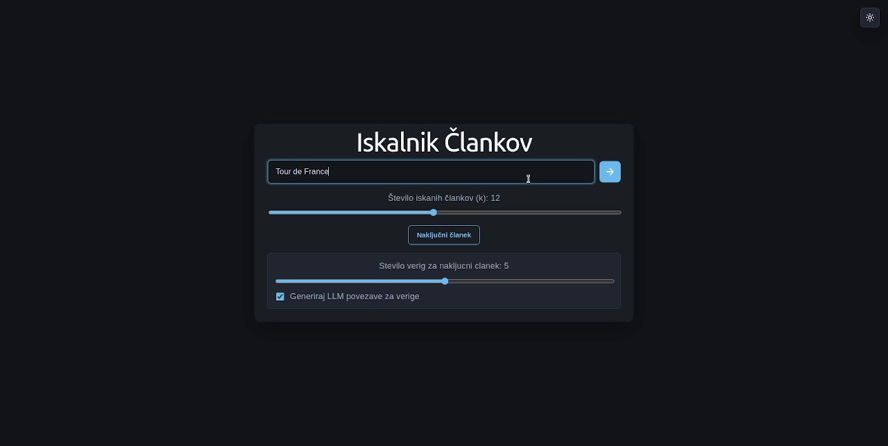
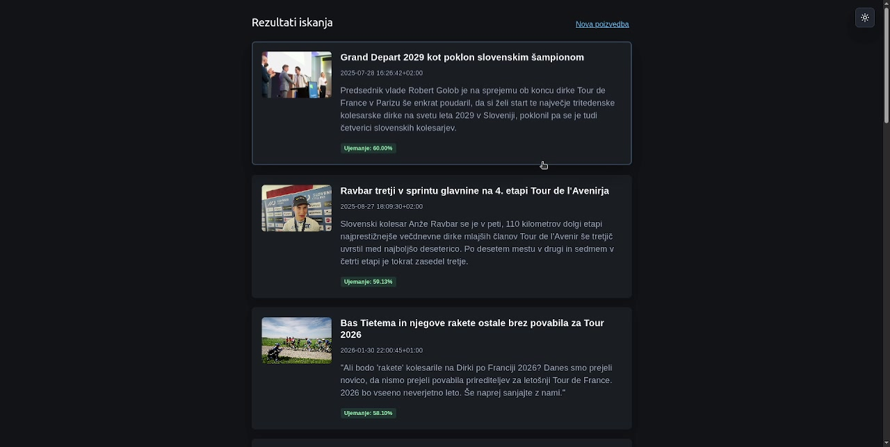
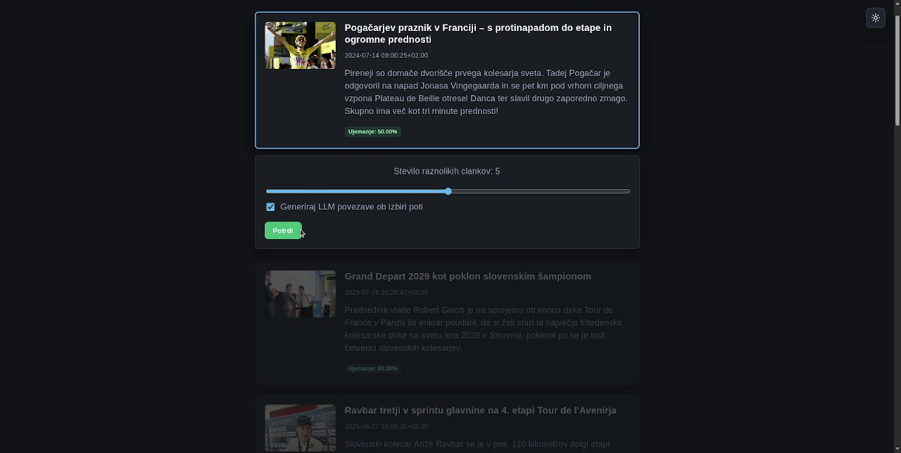
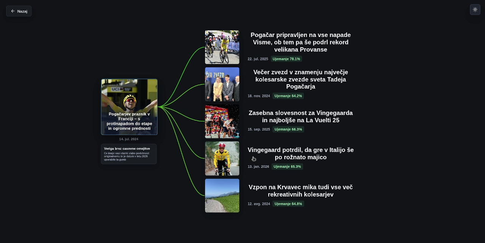
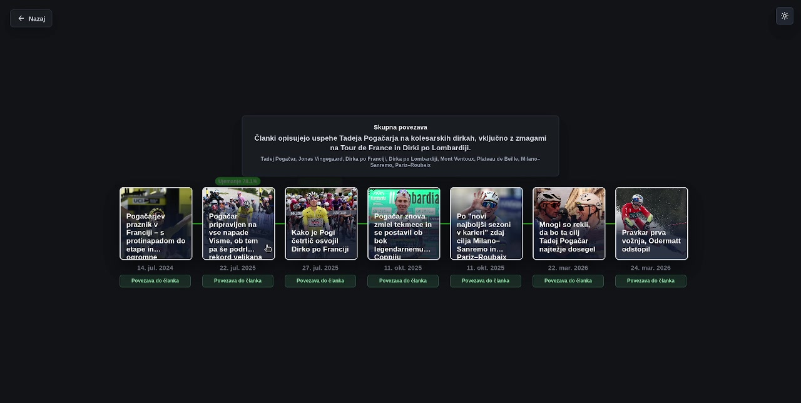
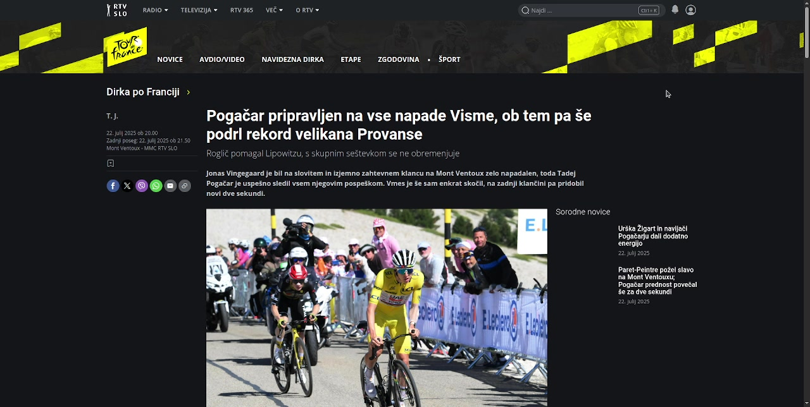
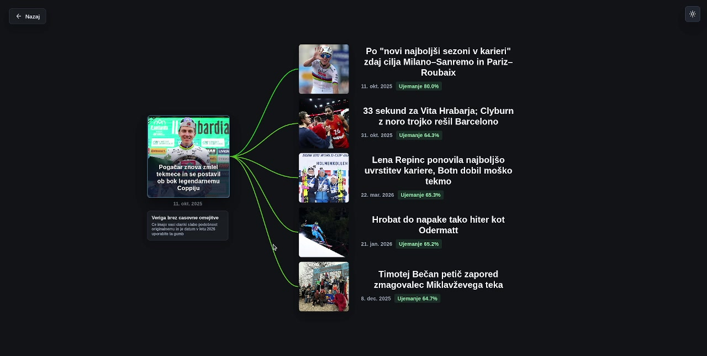
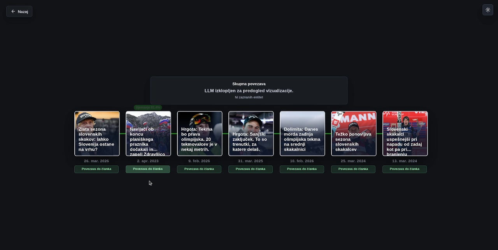

# Iskalnik Člankov — Article Explorer

An interactive webpage for searching Slovenian RTV MMC news articles and exploring how stories connect over time. Start with a search or a random article, choose several related but diverse directions, and expand a direction into a reading chain. The graph shows article thumbnails, publication dates, and similarity scores; optional AI explanations describe the common theme and named entities in a chain.

**[Watch the video demonstration on YouTube](https://youtu.be/NIdICdmnm3A).**


### 1. Search for a topic

Enter a query, such as `Tour de France`, and choose how many results to return with **Število iskanih člankov (k)** (5–20). Submit with the arrow button or Enter. Alternatively, **Naključni članek** picks a random article and opens its branches directly. The home screen also provides a branch-count slider and an option to generate AI explanations. The top-right button switches between light and dark themes.



*Recording: 00:01.*

### 2. Browse the ranked results

The results list displays each article's title, thumbnail, date, introduction, and **Ujemanje** (match score). Click a card to use it as the starting article. **Nova poizvedba** returns to the search screen.



*Recording: 00:10.*

### 3. Choose how many directions to explore

Selecting an article highlights it and reveals the exploration controls. Choose 3–7 diverse articles, enable or disable **Generiraj LLM povezave ob izbiri poti**, then click **Potrdi**. These articles become the first steps of separate reading chains.



*Recording: 00:14.5.*

### 4. Compare the branches

The starting article appears on the left, connected to several suggested articles on the right. Each branch represents a different direction within the related candidate articles. Dates and similarity percentages help compare the choices; connection colors move toward green as similarity increases.



*Recording: 00:18.*

### 5. Expand a reading chain

Click a branch to expand its chain. A full chain contains the starting article, the chosen branch article, and up to five additional articles. Normal chains move forward in publication time. Chains are built in the background, so the first branches can appear before all subsequent articles and explanations are ready.

When enabled, the **Skupna povezava** box shows an AI-generated explanation of the shared theme and a list of entities. **Nazaj** returns from the expanded chain to the branches, then from the branches to the results.



*Recording: 00:36.*

### 6. Read the original article

Use **Povezava do članka** below a chain node to open the original news article in another browser tab. Clicking the starting article in the branch overview also opens its source.



*Recording: 00:25; shown here alongside the source-link instructions.*

### 7. Continue exploring from another article

Click an article card inside an expanded chain to make it the new starting point. The app builds a fresh set of branches around that article, allowing exploration to continue without entering another query.



*Recording: 00:41.*

### 8. Explore without a date restriction

From the branch overview, **Veriga brez casovne omejitve** builds a single chain using similar articles regardless of publication date. This is useful near the end of the dataset, where few newer articles remain. This mode can move backward or forward in time and currently does not generate an AI explanation.



*Recording: 01:29.*

## How it works

The React/Vite frontend calls a FastAPI backend. The backend searches an existing PostgreSQL article collection using pgvector embeddings and PostgreSQL full-text search. An optional OpenAI-compatible API generates chain explanations.

### Search: meaning plus keywords

[recommender_weighted.py](query_to_recommendation/recommender_weighted.py) embeds the query with `sentence-transformers/paraphrase-multilingual-MiniLM-L12-v2`, producing a 384-dimensional vector. It retrieves up to 200 semantic candidates using pgvector's Euclidean-distance operator (`<->`) and up to 200 keyword candidates using `search_vec`, `plainto_tsquery('simple', ...)`, and `ts_rank`.

The candidate sets are combined, each score type is min–max normalized, and the final ranking uses:

```text
search score = 0.5 × normalized semantic score
             + 0.5 × normalized keyword score
```

The semantic score before normalization is `1 − embedding distance`. If no keyword candidates match, ranking uses semantic scores alone. If query embedding fails or semantic candidate retrieval times out, the search can fall back to keywords.

### Branches: related articles with varied directions

[find_groups.py](find_groups.py) retrieves up to 100 nearby articles published after the starting article. It seeds the selection with the most cosine-similar candidate, then greedily chooses vectors that contribute new directions after projecting out the starting vector and the previously selected directions. This volume-based selection aims to provide varied branches within a relevant neighborhood. Fewer branches can appear when there are insufficient candidates.

### Chains: following a story forward

[api_server.py](api_server.py) extends each branch by up to five articles. At each step, [find_next.py](find_next.py) combines normalized semantic similarity (weight `0.6`), alignment with a direction derived from the candidate neighborhood (`0.4`), and a preference for earlier candidates in the date-sorted list (`0.09`). Candidates must be newer than the current article. The builder excludes articles already used in the same exploration, including other branches, and stops when no candidates remain.

The date-unrestricted mode instead repeatedly chooses the nearest unused embedding without a date filter.

**Score interpretation:** search-result percentages are normalized hybrid ranking scores. Graph percentages are cosine similarities between connected articles, clamped to the range 0–1. They measure different things and are not probabilities.

### Background loading and explanations

The diverse-article endpoint returns the initial branches and a job ID. The backend builds chains in a thread pool, while the frontend polls for updates roughly every 1.2 seconds. Once the chains are ready, optional explanations are generated from their article titles and introductions.

[find_similarity.py](find_similarity.py) currently requests `DeepSeek-V4-Flash` through the OpenAI Python client, using the configured API endpoint. The prompt requests a short Slovenian connection description and named entities as JSON. Article selection and chain construction work with explanations disabled.

## Run locally

Clone the repository (the directory name below matches the commands in this guide):

```bash
git clone https://github.com/VidDolinsek/ArticleChain.git projekt-jek2
```

### Prerequisites

- Python 3.11 or newer is recommended, with `pip` and `venv` available.
- Node.js compatible with the installed Vite version: `20.19+` within Node 20, or `22.12+`, plus npm.
- Access to the project's populated PostgreSQL database, including the pgvector extension and article search data.
- Internet access for the initial embedding-model download, the remote database, and optional AI requests.

The runtime expects an `articles` table with `id`, `title`, `lead`, `paragraphs`, `date`, `link`, `thumbnail`, `embedding` (384-dimensional vectors from the same model), and `search_vec` (a populated full-text search vector). Installing Python dependencies does not create or populate this database.

The active backend connection is configured in `DB_CONFIG` in [recommender_weighted.py](query_to_recommendation/recommender_weighted.py). The host, port, database, and user are currently set in code; update that configuration if using another database.

### 1. Configure the environment

Use a `.env` file in the `projekt-jek2` directory. If one already exists, keep its working values. The following shows the relevant variables with placeholders:

```dotenv
DB_PASSWORD=your_database_password

# Optional: needed only for AI-generated explanations.
ENDPOINT=https://your-provider.example/v1
API_KEY=your_api_key

# Set to 1 to disable AI explanation calls on the backend.
DISABLE_LLM_SIMILARITY=0
```

The explanation endpoint must support the model named in `find_similarity.py`; adjust `model_name` there if your provider uses a different model identifier. To explore without an AI account, uncheck the explanation option in the webpage, or set `DISABLE_LLM_SIMILARITY=1`. The `.env` file is ignored by Git.

### 2. Start the backend

From the parent directory containing `projekt-jek2`:

```bash
cd projekt-jek2
python3 -m venv .venv
source .venv/bin/activate
python -m pip install -r requirements.txt
python -m uvicorn api_server:app --reload
```

The API runs at **http://127.0.0.1:8000**, with interactive API documentation at **http://127.0.0.1:8000/docs**. Startup loads the embedding model; the first run may take longer while the model is downloaded.

On subsequent runs, from `projekt-jek2`, use:

```bash
source .venv/bin/activate
python -m uvicorn api_server:app --reload
```

### 3. Start the frontend in another terminal

Again starting from the parent directory containing `projekt-jek2`:

```bash
cd projekt-jek2/frontend
npm ci
npm run dev
```

Open the URL printed by Vite, normally **http://localhost:5173**. On subsequent runs, `npm run dev` is enough unless dependencies changed. Stop either server with `Ctrl+C` in its terminal.

The frontend defaults to `http://127.0.0.1:8000` for API calls. To use another backend, set `VITE_API_BASE_URL` in `frontend/.env.local` and restart Vite:

```dotenv
VITE_API_BASE_URL=http://127.0.0.1:8000
```

### Build the frontend

From `projekt-jek2/frontend`:

```bash
npm run build
npm run preview
```

The build is written to `frontend/dist`. The backend must still run separately. For the configured static server on port 8080, run `npm start` after building. `VITE_API_BASE_URL` is embedded at build time, so set it before building when targeting a deployed backend.

### Package the backend for deployment

From the `projekt-jek2` directory, run:

```bash
./create_backend
```

The script copies the backend source into `build/backend/` and creates `build/backend.zip` for deployment. Both outputs are generated and ignored by Git; edit the source files in the project root and `query_to_recommendation/`, then rerun the script to rebuild the package. The frontend remains in the same repository under `frontend/` and is built separately.

Configure the environment variables on the deployment host. The package does not include your local `.env`. For Azure, use this startup command:

```bash
gunicorn -w 1 -k uvicorn.workers.UvicornWorker -b 0.0.0.0:8000 api_server:app --timeout 600
```

## API overview

| Endpoint | Purpose |
| --- | --- |
| `GET /api/search?q=...&k=20` | Search and rank articles. |
| `GET /api/random` | Pick a random article with an embedding. |
| `GET /api/diverse?article_id=...&x=5&include_llm=true` | Select diverse branches and start background chain construction. |
| `GET /api/chain-jobs/{job_id}` | Retrieve chain progress, results, and explanations. |
| `GET /api/timeless-chain?article_id=...` | Build a chain without publication-date restrictions. |
| `POST /api/route-explanations` | Generate explanations for an ordered list of article IDs. |
| `POST /api/chain-summaries` | Generate summaries for supplied article paths. |

See `/docs` on the running backend for request bodies and response details. Background jobs are stored in process memory, so use a single backend worker for this implementation; restarting the backend clears active jobs.

## Project layout

| Path | Role |
| --- | --- |
| `frontend/` | React interface, graph rendering, styling, and Vite configuration. |
| `api_server.py` | FastAPI routes, chain construction, and background jobs. |
| `create_backend` | Packages backend source into the ignored `build/` directory for deployment. |
| `query_to_recommendation/recommender_weighted.py` | Active query embedding and hybrid search implementation. |
| `find_groups.py` | Candidate retrieval and diverse branch selection. |
| `find_next.py` | Selection of the next article in a chronological chain. |
| `find_similarity.py` | Optional AI explanations and entity extraction. |
| `generate_embeddings/` | Offline article import, text updates, and embedding generation scripts. |
| `test_transformerjev/` | Embedding experiments and evaluation/report scripts. |
| `frontend_route_app.py`, `query_to_recommendation/app.py` | Earlier Streamlit interfaces, separate from the React webpage described here. |
| `docs/screenshots/` | Frames from the demonstration recording used in this README. |

`requirements.txt` covers the active API runtime. The offline preparation scripts and earlier interfaces may require additional packages and configuration; they are not part of the normal webpage startup sequence.

## Troubleshooting

- **Vite reports an unsupported Node version:** check `node --version` against the prerequisites above.
- **The webpage loads but search fails:** confirm the backend is running, check its terminal output, and verify database credentials and connectivity. If the API runs elsewhere, configure `VITE_API_BASE_URL`.
- **Database errors mention missing columns or vectors:** the app expects the prepared article dataset, full-text search vector, and compatible 384-dimensional embeddings.
- **Few or no branches appear:** normal exploration only considers newer articles. Try the date-unrestricted chain or start from an older article.
- **Explanations show an error:** verify `ENDPOINT`, `API_KEY`, and the model identifier, or disable explanations and continue exploring.
- **Search is slow:** the model may still be loading, or database queries may be slow. Optional backend environment variables are `SEARCH_CANDIDATE_LIMIT` (default `200`), `DB_STATEMENT_TIMEOUT_MS` (default `10000`), and `DEBUG_SEARCH_TIMING=1` for search timing logs.
